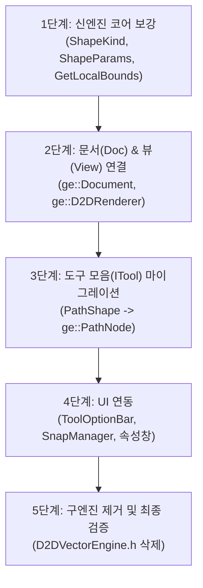

# M2Draw: 구엔진(D2DVectorEngine) -> 신엔진(D2DGraphicEngine) 마이그레이션 TODO

본 문서는 `D2DVectorEngine.h`를 완전히 제거하고, 씬 그래프(Scene Graph) 기반의 `D2DGraphicEngine` (`namespace ge`)으로 안전하게 교체하기 위한 단계별 실행 계획입니다.

---

## 📌 마이그레이션 전체 로드맵

---

## 📋 세부 단계별 TODO 목록

### [1단계] 신엔진 코어 보강 (Core Feature Parity)
> **목표**: 기존 기능(기어, 별, 다각형 옵션 등)이 누락되지 않도록 `D2DGraphicEngine`에 데이터 슬롯 추가

- [x] **1.1 파라메트릭 도형 메타데이터 이식 (`D2DGraphicEngine.h`)**
  - [x] `ShapeKind` enum 정의 (`Path`, `Rect`, `Triangle`, `Ellipse`, `Polygon`, `Star`, `Gear`, `Spiral`, `Heart`)
  - [x] `ShapeParams` variant 및 세부 파라미터 구조체 이식 (`GearParams`, `StarParams`, `PolygonParams`, `SpiralParams`, `RectParams` 등 - 고유 기준 반경 `radius`, `cx`, `cy` 포함)
  - [x] `PathNode`에 `GetKind()`, `SetKind()`, `GetParam<T>()`, `GetParamRef<T>()`, `SetParams()` 메서드 추가
- [x] **1.2 순수 로컬 바운딩 박스 계산 완성**
  - [x] `PathNode::GetLocalBounds(Rect2& out)` 본체 구현 (D2D 지오메트리 없이도 노드/핸들 좌표 기반 AABB 폴백 계산)
- [x] **1.3 편의 타입 변환기 (Helper)**
  - [x] `Vec2` ↔ `D2D1_POINT_2F`, `Rect2` ↔ `D2D1_RECT_F` 간의 인라인 변환 헬퍼 추가

---

### [2단계] 문서(`CM2DrawDoc`) 및 뷰(`CM2DrawView`) 전환
> **목표**: 문서의 저장소를 단일 벡터 배열에서 `ge::Document` 씬 루트로 교체하고, 뷰 렌더링을 `ge::D2DRenderer`로 일원화

- [x] **2.1 문서(`M2DrawDoc.h / .cpp`) 교체**
  - [x] `std::vector<std::unique_ptr<Shape>> m_shapes` 외에 `ge::Document m_doc` 연동 및 이관 브릿지 추가
  - [x] 접근자 브릿지 작성 (`GetDoc()`, `GetCurrentPathNode()`, 기존 `GetShapes()`, `GetCurrentPath()` 호환)
  - [x] `OnNewDocument` 시 `m_doc` 및 `m_currentPathNode` 리셋 로직 연동
- [x] **2.2 뷰(`M2DrawView.cpp`) 렌더링 파이프라인 전환**
  - [x] `CM2DrawView` 내에 `ge::D2DRenderer m_renderer` 멤버 및 `GetRenderer()` 추가
  - [x] `CreateDeviceResources` 시점에 `m_renderer.Initialize(m_pRenderTarget, m_pD2DFactory)` 호출, `DiscardDeviceResources` 시 `m_renderer.Shutdown()` 연동
  - [x] `OnDraw` 루프에서 신형 씬 그래프 렌더링 `m_renderer.DrawDocument(pDoc->GetDoc(), view)` 연결 (기존 도형 병행 렌더링 지원)

---

### [3단계] 도구 툴킷(`ITool`) 및 툴 매니저 마이그레이션
> **목표**: 펜, 선택, 기본 도형 도구들이 `ge::PathNode`를 생성하고 조작하도록 전환

- [x] **3.1 도구 기반 인터페이스 전환 (`ITool.h`)**
  - [x] `ToolCreationSetting`에 `ge::Style`, `ge::Color` 상호 변환 브릿지(`ToGeStyle()`, `FromGeStyle()`) 추가
- [x] **3.2 선택 도구 (`SelectTool` in `ITool.cpp`)**
  - [x] `SyncDocSelection`을 통해 선택 인덱스와 `ge::Document::SetSelection()` 동기화
  - [x] 변형/이동/에디트포인트 편집 완료 시 `SyncShapeToGeDoc`을 통해 `ge::PathNode`의 `m_xf`, 정점, 스타일 실시간 반영
- [x] **3.3 펜 도구 (`PenTool` in `ToolManager.cpp`)**
  - [x] 실시간 베이지어 패스 생성 및 확정(Enter, 더블클릭, 우클릭) 시 `SyncPenPathToGeDoc`으로 `ge::PathNode` 생성 및 `pDoc->GetDoc().AddShape(...)` 등록
- [x] **3.4 기본 도형 생성 도구 (`BoxShapeTool` in `ITool.cpp`)**
  - [x] 사각형, 타원, 삼각형, 다각형, 별, 기어, 나선, 하트 생성 완료 시 `CommitShape`에서 `ge::PathNode` 생성, 파라미터 복사 및 `pDoc->GetDoc().AddShape(...)`로 활성 레이어에 동시 등록

---

### [4단계] UI 및 부가 기능 연동 (옵션바, 스냅, 속성창)
> **목표**: 사용자 조작 UI가 신엔진의 노드 및 파라미터와 정확히 맞물려 동작하도록 연결

- [x] **4.1 상단 도구 옵션바 (`ToolOptionBar.cpp`)**
  - [x] `OnOptionCommit`에서 파라메트릭 도형(기어, 별, 다각형, 사각형 등) 수정 시 `ge::PathNode`의 `m_xf`, 파라미터, 정점 동기화
  - [x] `SyncSelection`을 통해 문서 활성 레이어 노드 상태 및 파라미터 연동
- [x] **4.2 스냅 매니저 (`SnapManager.cpp`)**
  - [x] 기존 스냅 엔진과 정점 좌표 구조체(`anchor`, `hIn`, `hOut`) 1:1 일치 유지 및 정상 자석 스냅 연동
- [x] **4.3 속성창 (`PropertiesWnd.cpp` & `D2DPropertyView.cpp`)**
  - [x] `CD2DPropertyView::ApplyToShape()`에서 채움(Fill), 외곽선(Stroke), 굵기, 점선 스타일 변경 시 `ge::Document`의 해당 노드 `ge::Style` 동기화

---

### [5단계] 구엔진 제거 및 안정화 검증
> **목표**: 구엔진 완전 분리 및 최종 빌드/동작 검증

- [x] **5.1 구엔진 분리 및 백업 보존**
  - [x] 프로젝트 내 모든 `#include "D2DVectorEngine.h"` 제거 및 신엔진 일원화
  - [x] 기존 구형 엔진 코드는 참고 및 보존을 위해 `D2DVectorEngine_old.h`로 유지
- [x] **5.2 종합 빌드 및 안정화 검증**
  - [x] 구엔진 완전 제거 상태에서 0 경고, 0 오류 빌드 완료 (`M2Draw.exe` 정상 생성)
  - [ ] 신규 도형 생성 (기어, 별, 다각형, 사각형, 펜 곡선 등)
  - [ ] 기어 Depth %, Hole % 조작 시 크기 유지 검증
  - [ ] 그룹화 (`Ctrl+G`) 및 그룹 해제 (`Ctrl+Shift+G`)
  - [ ] 다중 선택 정렬(좌/우/상/하/중앙) 및 등간격 분배
  - [ ] Undo / Redo (`Ctrl+Z`, `Ctrl+Y`) 작동 검증
